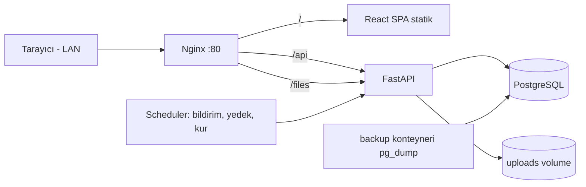

# KÜP INVENTORY – Mimari Dokümanı

## 1. Sistem Mimarisi

- 3 katman: Frontend (statik build) / Backend API (stateless) / PostgreSQL (yalnızca sunucuda).
- Tüm bağımlılıklar yerel (CDN, font, bulut yok). Fontlar paketlenir.
- Kimlik: JWT access (15 dk, bellekte) + refresh (httpOnly, SameSite=Strict cookie, DB'de hash'li, rotasyonlu). Cookie kullanan uçlarda CSRF double-submit.
- Yetki: backend dependency `require_permission("module.action")`.
- Çok kiracılılık: tüm iş tablolarında `tenant_id` (UUID), varsayılan tek tenant.
- Para: `NUMERIC(18,4)`; zaman: `TIMESTAMPTZ` (UTC saklanır, UI Europe/Istanbul).
- PDF: ReportLab (tamamen yerel, Türkçe için paketlenmiş DejaVu/Inter TTF).
- Değerleme sağlayıcı arayüzü (`ValuationProvider`) – varsayılan yalnızca manuel; kaynak yoksa değer üretilmez, öneri kullanıcı onayı olmadan uygulanmaz.

## 2. Klasör Yapısı
```
kup-inventory/
├─ docker-compose.yml  .env.example  README.md
├─ nginx/default.conf
├─ docs/ (architecture, ER, API, checklists)
├─ backend/
│  ├─ Dockerfile  requirements.txt  alembic.ini
│  ├─ alembic/versions/
│  └─ app/
│     ├─ main.py  core/(config, security, deps, permissions)
│     ├─ db/(base, session, mixins)
│     ├─ models/ schemas/ services/ api/v1/ (modül başına)
│     ├─ reports/ (pdf)  jobs/ (scheduler)  seed/
│     └─ tests/
├─ frontend/
│  └─ src/ (app, components/ui, components/layout, features/<modül>, lib, hooks, i18n, pages)
└─ storage/ (uploads, backups – volume)
```

## 3. ER Diyagramı (özet)

```mermaid
erDiagram
  USERS ||--o{ USER_ROLES : has
  ROLES ||--o{ USER_ROLES : has
  ROLES ||--o{ ROLE_PERMISSIONS : has
  PERMISSIONS ||--o{ ROLE_PERMISSIONS : in
  CATEGORIES ||--o{ PRODUCTS : groups
  BRANDS ||--o{ MODELS : makes
  MODELS ||--o{ PRODUCTS : describes
  PRODUCTS ||--o{ ASSETS : "serialized units"
  PRODUCTS ||--o{ STOCK_BALANCES : "quantity based"
  WAREHOUSES ||--o{ WAREHOUSE_LOCATIONS : contains
  WAREHOUSES ||--o{ STOCK_BALANCES : holds
  ASSETS ||--o{ STOCK_MOVEMENT_ITEMS : moved
  STOCK_MOVEMENTS ||--o{ STOCK_MOVEMENT_ITEMS : has
  STOCK_MOVEMENTS ||--o| TRANSFERS : "approval"
  PROJECTS ||--o{ PROJECT_ASSETS : uses
  ASSETS ||--o{ PROJECT_ASSETS : assigned
  EMPLOYEES ||--o{ ASSIGNMENTS : receives
  ASSIGNMENTS ||--o{ ASSIGNMENT_ITEMS : has
  ASSIGNMENT_ITEMS ||--o{ ASSIGNMENT_RETURNS : returned
  SOFTWARE_PRODUCTS ||--o{ SOFTWARE_LICENSES : has
  SOFTWARE_LICENSES ||--o{ LICENSE_ASSIGNMENTS : assigned
  SOFTWARE_LICENSES ||--o{ LICENSE_RENEWALS : renewed
  ASSETS ||--o{ VALUATIONS : valued
  ASSETS ||--o{ PURCHASE_RECORDS : bought
  ASSETS ||--o{ DEPRECIATION_RECORDS : depreciates
  CURRENCIES ||--o{ EXCHANGE_RATES : rates
  ASSETS ||--o{ MAINTENANCE_RECORDS : maintained
  ASSETS ||--o{ SERVICE_RECORDS : serviced
  ASSETS ||--o{ MAINTENANCE_SCHEDULES : scheduled
  STOCKTAKES ||--o{ STOCKTAKE_ITEMS : counts
  STOCKTAKES ||--o{ STOCKTAKE_APPROVALS : approved
  USERS ||--o{ AUDIT_LOGS : acts
  USERS ||--o{ NOTIFICATIONS : receives
```


## 4. Tablolar ve Alanlar
**Ortak kolonlar (tüm iş tablolarında):** `id UUID PK`, `tenant_id UUID FK IDX`, `created_at/updated_at TIMESTAMPTZ`, `created_by/updated_by UUID`, `is_deleted BOOL`, `deleted_at TIMESTAMPTZ`. (audit_logs, stock_movements, valuations vb. append-only: sadece created_*.)

### CORE
- **users**: email UNIQUE, username, password_hash, full_name, is_active, is_superuser, last_login_at, failed_attempts INT, locked_until, employee_id FK, theme, language
- **roles**: name, code (ADMIN…CUSTOM), description, is_system
- **permissions**: code UNIQUE (`product.create`), module, action, description
- **role_permissions**: role_id, permission_id (PK birleşik)
- **user_roles**: user_id, role_id
- **refresh_tokens**: user_id, token_hash, expires_at, revoked_at, ip, user_agent
- **departments**: name, parent_id
- **employees**: full_name, department_id, position, email, phone, is_active
- **settings**: key, value JSONB, scope

### INVENTORY
- **categories**: name, parent_id (alt kategori), code, tracking_type ENUM(serial, quantity), icon
- **brands**: name UNIQUE/tenant
- **models**: brand_id, name, specs JSONB
- **products**: category_id, model_id, name, sku, description, unit, tracking_type, default_vat NUMERIC(5,2), barcode, min_stock NUMERIC, photo_file_id, is_active
- **assets**: product_id, inventory_code UNIQUE, serial_number (UNIQUE partial/tenant), barcode, qr_token UNIQUE (rastgele, hassas veri yok), status ENUM(active, in_warehouse, in_project, assigned, faulty, in_service, scrapped, passive), warehouse_id, location_id, project_id, employee_id, condition, warranty_start/end, notes
- **product_images / product_documents**: product_id|asset_id, file_id, kind, caption
- **product_attributes**: product_id, key, value
- **suppliers**: name, tax_no, phone, email, address

### WAREHOUSE
- **warehouses**: name, code, type ENUM(central, workshop, office, project, service), address
- **warehouse_locations**: warehouse_id, parent_id, code, name, kind(shelf/section/area)
- **stock_balances**: product_id, warehouse_id, location_id, quantity NUMERIC(18,3) CHECK ≥0 · UNIQUE(product,warehouse,location)
- **stock_movements**: type ENUM(initial, purchase, manual_in, out, to_project, from_project, transfer, assign, unassign, to_service, from_service, scrap, count_diff, adjustment, reversal), occurred_at, user_id, project_id, employee_id, from_warehouse_id/from_location_id, to_*, note, reverses_id FK
- **stock_movement_items**: movement_id, product_id, asset_id NULL, quantity
- **transfers**: movement_id, status(pending/approved/rejected), requested_by, approved_by, approved_at

### PROJECT
- **projects**: name, code, customer, start_date, end_date, manager_employee_id, address, status, description
- **project_assets**: project_id, product_id, asset_id NULL, quantity, sent_at, returned_at, status
- **project_movements**: project_id, movement_id

### ASSIGNMENT
- **assignments**: employee_id, delivered_by, delivered_at, document_file_id, signature_file_id, note
- **assignment_items**: assignment_id, product_id, asset_id NULL, quantity
- **assignment_returns**: item_id, quantity, returned_at, received_by, document_file_id, note

### LICENSE
- **software_products**: name, vendor, version
- **software_licenses**: software_product_id, license_type ENUM(perpetual, annual, monthly, per_user, per_device, per_server, per_project), key_encrypted (AES-GCM/Fernet), license_no, purchase_date, start_date, end_date, seats_total, seats_used, cost NUMERIC(18,4), currency, supplier_id, invoice_file_id, contract_file_id, notes
- **license_assignments**: license_id, asset_id|employee_id, assigned_at, released_at
- **license_renewals**: license_id, renewed_at, new_end_date, cost, currency

### FINANCE
- **currencies**: code PK (TRY, EUR, USD), name, symbol
- **exchange_rates**: date, currency_code, rate_to_try NUMERIC(18,6), source ENUM(manual, …), updated_at · UNIQUE(date,currency)
- **valuations** (append-only): asset_id|product_id, value NUMERIC(18,4), currency, condition, source, valuation_date, note, status(proposed/approved), approved_by
- **purchase_records** (değişmez): asset_id|product_id, purchase_date, unit_price, currency, vat_rate, supplier_id, invoice_no, quantity, correction_of_id
- **depreciation_records**: asset_id, period, method, amount, net_book_value, rate_snapshot

### MAINTENANCE
- **maintenance_records**: asset_id, kind, description, performed_at, cost, technician_id
- **service_records**: asset_id, fault_type, description, service_company, sent_at, returned_at, labor_cost, parts_cost, total_cost, warranty_covered, report_file_id, result
- **maintenance_schedules**: asset_id, interval_days, next_due_at, last_done_at

### COUNT
- **stocktakes**: warehouse_id, count_date, responsible_user_id, status(open/counting/review/approved/cancelled)
- **stocktake_items**: stocktake_id, product_id, asset_id, expected_qty, counted_qty, found_location_id, result ENUM(found, missing, extra, wrong_location, serial_mismatch)
- **stocktake_approvals**: stocktake_id, approved_by, approved_at, note

### SYSTEM
- **notifications**: user_id|role, type, title, body, link, severity, read_at, dedupe_key UNIQUE
- **audit_logs** (append-only, DB trigger UPDATE/DELETE engeller): user_id, action, entity, entity_id, old_value JSONB, new_value JSONB, ip, created_at
- **file_attachments**: storage_path, original_name, mime, size, sha256, owner_type, owner_id
- **backup_records**: kind(auto/manual), status, file_path, size, started_at, finished_at, error
- **app_licenses / app_license_activations**: license_key_hash, customer, max_users, features JSONB, expires_at, signature; activation: machine_fingerprint, activated_at

## 5. İlişki Kuralları
- Ürün (katalog) → Varlık (seri) 1:N; adet bazlı ürünler yalnızca `stock_balances` + hareketler.
- Bakiye değişimi yalnızca servis katmanında, tek transaction + `SELECT … FOR UPDATE`; CHECK(quantity ≥ 0).
- Transfer onaylanana kadar asset/bakiye lokasyonu değişmez.
- Hareket/değerleme/alış kaydı/audit silinmez; düzeltme = ters kayıt (`reverses_id`, `correction_of_id`).
- Geçmiş raporlar kur snapshot'ı (`report_snapshots` JSONB, rapor üretildiğinde kurlar kaydedilir).

## 6. API Endpoint Listesi (`/api/v1`)
| Modül | Uçlar |
|---|---|
| auth | POST login, refresh, logout; GET me; POST change-password |
| users/roles | CRUD users; CRUD roles; GET permissions; PUT roles/{id}/permissions; PUT users/{id}/roles |
| employees/departments | CRUD |
| categories/brands/models/suppliers | CRUD |
| products | CRUD, POST bulk, POST {id}/images, /documents |
| assets | CRUD, POST bulk (seri listesi), PATCH status, GET {id}/history, GET {id}/qr.png |
| public QR | GET /q/{qr_token} (kimlik doğrulamasız minimal, salt okunur) |
| warehouses/locations | CRUD, GET stock |
| movements | GET list, POST create, POST {id}/reverse |
| transfers | POST, GET, POST {id}/approve, /reject |
| projects | CRUD, POST {id}/send, /return, GET {id}/summary |
| assignments | CRUD, POST {id}/return, GET {id}/pdf, GET employees/{id}/assets |
| licenses | CRUD, POST {id}/assign, /renew, GET {id}/key (ayrı yetki + audit) |
| maintenance/service | CRUD records, schedules, GET assets/{id}/cost |
| stocktakes | POST, POST {id}/scan, GET {id}/result, POST {id}/approve |
| valuations/fx | GET/POST valuations, POST {id}/approve, GET provider-suggestion; CRUD exchange-rates |
| dashboard | GET summary, charts/*, drill-down lists |
| reports | GET types, POST preview, POST generate (PDF), GET {id}/download |
| notifications | GET, POST {id}/read, read-all |
| audit | GET (salt okunur, filtreli) |
| backups | GET, POST run, POST {id}/restore, GET status |
| settings / app-license | GET/PUT; POST activate; GET status |
| system | GET /health, /ready |

## 7. Yetki Matrisi
Yetki kodu biçimi `modül.işlem` (view, create, update, deactivate, …). ● tam  ○ kısmi  – yok

| Modül | ADMIN | INV_MGR | TECH | PROJ_MGR | VIEWER |
|---|---|---|---|---|---|
| Ürün/Varlık görüntüle | ● | ● | ● | ● | ● |
| Ürün ekle/düzenle/pasifleştir | ● | ● | – | – | – |
| Değer (valuation) değiştir/onayla | ● | ● | – | – | – |
| Stok hareketi oluştur | ● | ● | ○ servis | ○ proje | – |
| Transfer onayı | ● | ● | – | – | – |
| Depo/Kategori yönetimi | ● | ● | – | – | – |
| Proje / proje ekipmanı | ● | ○ görüntüle | – | ● | görüntüle |
| Zimmet | ● | ● | – | – | görüntüle |
| Lisans görüntüle / anahtarı görüntüle | ●/● | ●/– | –/– | –/– | ●/– |
| Bakım & servis | ● | görüntüle | ● | – | görüntüle |
| Sayım yap / onayla | ●/● | ●/● | ○/– | – | –/– |
| Rapor görüntüle/PDF | ● | ● | ○ | ○ | ● |
| Audit log | ● | – | – | – | – |
| Kullanıcı/rol, yedek, ayarlar, sistem lisansı | ● | – | – | – | – |
CUSTOM_ROLE: ADMIN'in `role_permissions` üzerinden seçtiği serbest kombinasyon. Backend her uçta kontrol eder; UI yalnızca gizler.

## 8. Geliştirme Aşamaları
PHASE 1–8 istendiği gibi. Her aşama çıkışında: migration up/down testi, pytest API testleri, frontend build+lint, tamamlanma checklist'i (`docs/checklists/phaseN.md`). Onay olmadan sonraki aşamaya geçilmez.

## 9. Güvenlik Planı
- Parola: Argon2id; politika (≥10 karakter); 5 hatalı denemede geçici kilit; login rate limit.
- JWT kısa ömürlü; refresh rotasyonu ve iptal; secret'lar `.env`.
- RBAC backend dependency; varsayılan red.
- SQLAlchemy parametreli sorgular (ham SQL yok); Pydantic doğrulama.
- XSS: React kaçışlama, CSP + güvenlik başlıkları Nginx'te; PDF/HTML'de kullanıcı girdisi kaçışlı.
- CSRF: refresh cookie SameSite=Strict + CSRF header; access token Authorization header'da.
- Dosya: MIME + magic-byte kontrolü, uzantı beyaz liste, boyut sınırı (Nginx + API), rastgele dosya adı, web köküne dışarıda saklama.
- Lisans anahtarı: Fernet/AES-GCM ile şifreli; açığa çıkarma ayrı yetki + audit; liste uçlarında maskeli.
- QR: yalnızca rastgele token; herkese açık sayfa minimal bilgi ve salt okunur.
- Audit append-only (DB trigger + uygulama hesabında DELETE/UPDATE yetkisi yok).
- Yedek: günlük pg_dump + uploads arşivi, rotasyon, hata → admin bildirimi.
- LAN'da HTTPS: opsiyonel kendinden imzalı sertifika (Nginx'te hazır blok).

## 10. Docker ve Sunucu Kurulumu
Servisler: `db` (postgres:16, volume), `backend` (uvicorn, alembic upgrade head açılışta), `frontend` (build → nginx), `nginx` (reverse proxy, :80), `backup` (cron pg_dump).
Kurulum: Ubuntu/Windows+Docker → `.env` oluştur → `docker compose up -d --build` → ilk admin seed → `inventory.local` için yerel DNS/hosts veya sabit IP (192.168.1.100). Çevrimdışı kurulum için imajlar `docker save` ile taşınabilir; build sırasında yalnızca ilk kurulumda internet gerekir (veya hazır imajlar).
